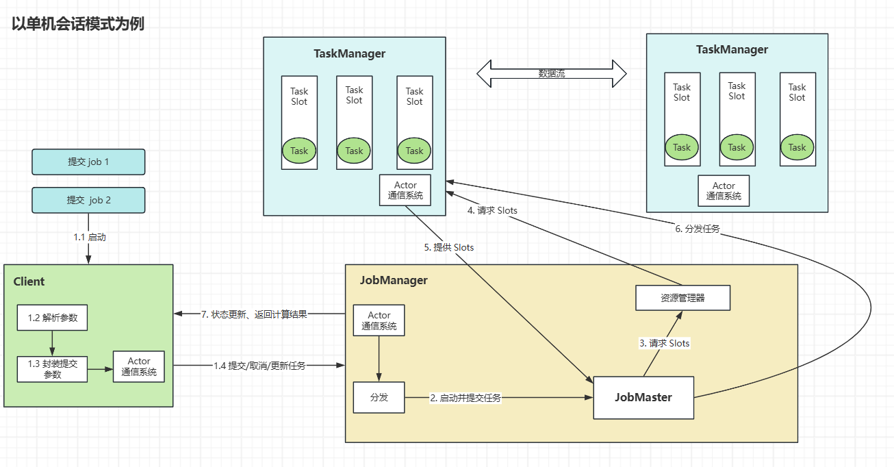
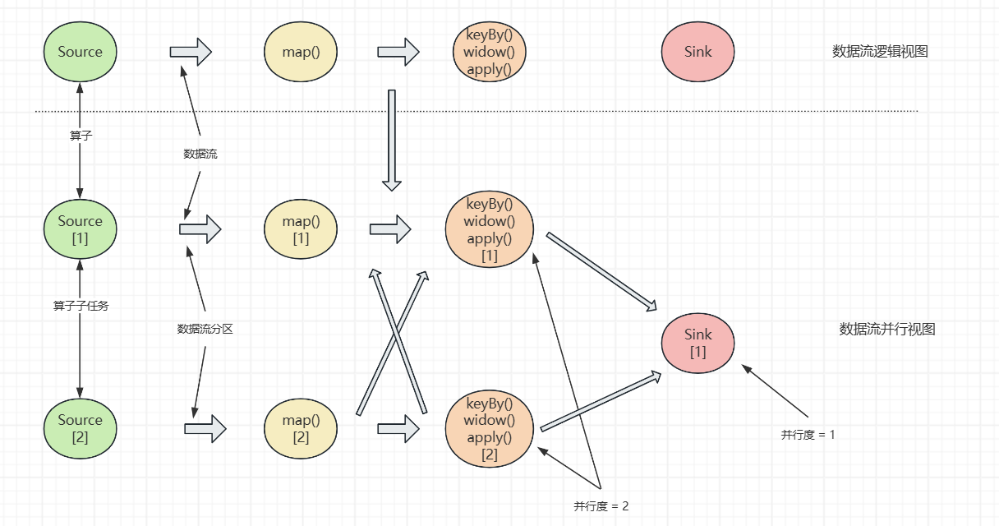
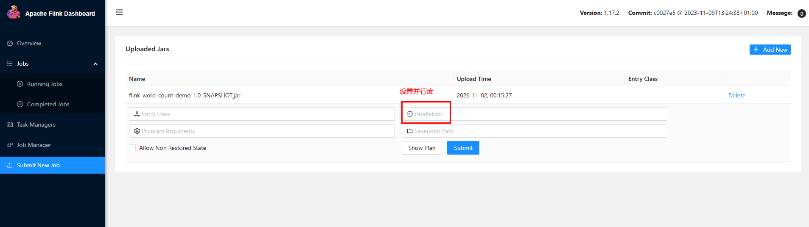
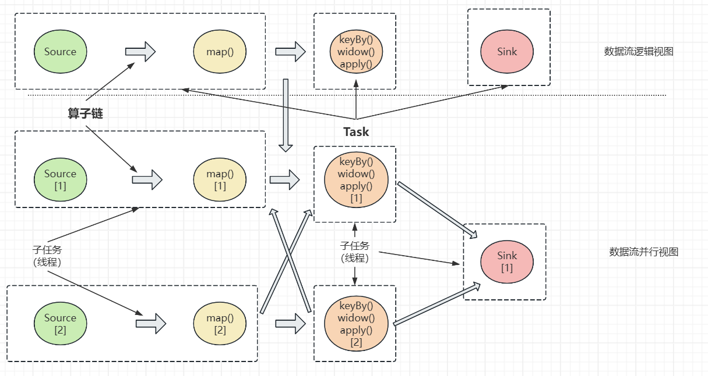
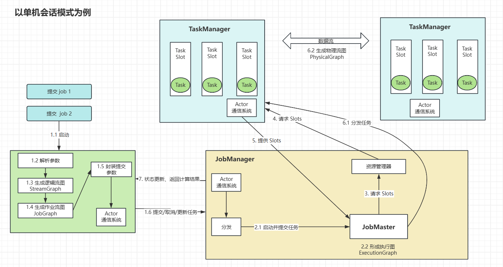
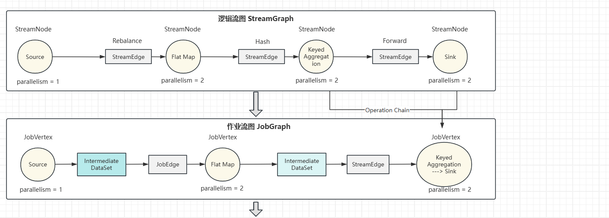
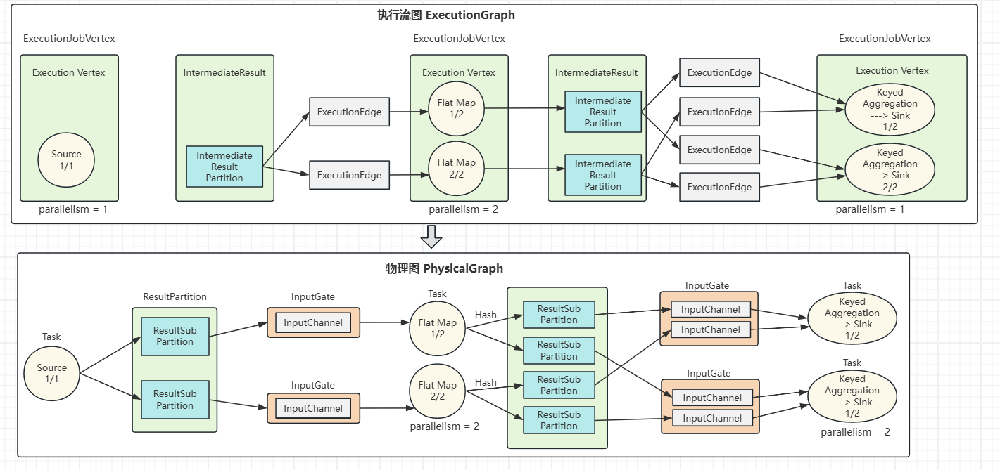
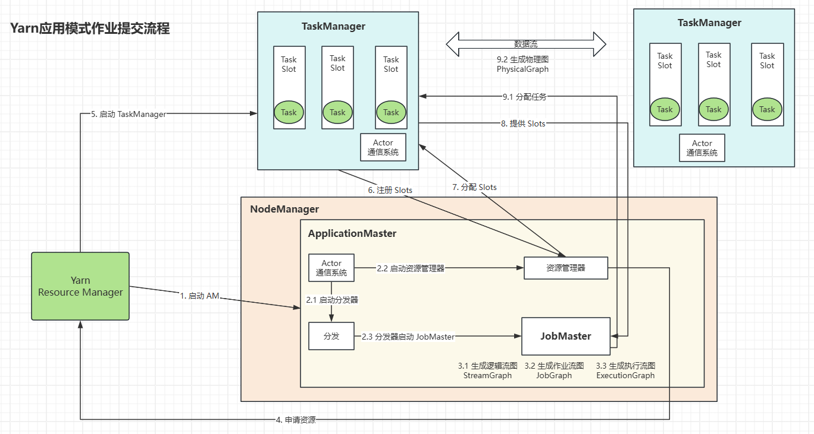
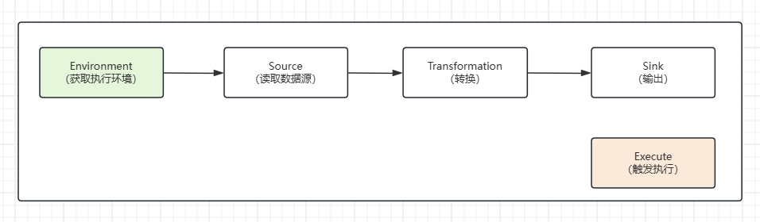

## Flink

*参考b站尚硅谷陈教授 Flink 1.17.0*


### 一、部署模式

#### 1. 会话模式（Session Mode）

概念：启动集群，保持一个会话，在这个会话中通过客户端提交作业，在集群启动时，所有的资源就已确定并加载，所提交的作业会竞争集群中的资源，适用于**单个规模较小、执行时间短的大量作业**。


#### 2. 单作业模式（Pre - Job Mode）

概念：为每个提交的作业启动一个集群，作业完成后，集群就会关闭且释放对应的资源。该模式需要借助资源管理框架（YARN、K8s等）来启动集群，Flink 本身无法以该模式直接运行。


#### 3. 应用模式（Application Mode）

概念：为每一个提交的作业单独启动一个 JobManager（即创建一个集群，由 JobManager 直接执行应用程序），单作业模式下，由客户端解析应用，再提交给 JobManager，资源占用较大。


### 二、运行模式

#### 1. Standalone

独立运行模式不依赖外部资源管理平台，一般用于开发、测试环境。


##### （1）会话模式

提前启动集群（集群资源是固定的），并通过 Web 页面客户端提交作业


##### （2）单作业模式

Flink 的 Standalone 集群不支持单作业模式部署，需借助外部平台。


##### （3）应用模式

通过官方文件的 standalone-job.sh 脚本来创建一个 JobManager。

注：执行的作业/应用需放置于 lib 目录下


#### 2. YARN

客户端将 Flink 应用提交给 Yarn 的 ResourceManager，ResourceManager 会向 Yarn 的 NodeManager 申请容器，Flink 会在申请到的容器上部署 JobManager 和 TaskManager 实例，从而启动集群，同时 Flink 会根据运行在 JobManager 上的作业所需要的 Slot 数量动态分配 TaskManager 资源。


##### （1）环境准备

Yarn 模式需要 Hadoop 和 HDFS，配置 Hadoop 环境变量

```bash
nano /etc/profile

HADOOP_HOME=/home/workspace/hadoop-3.3.4
export PATH=$PATH:$HADOOP_HOME/bin:$HADOOP_HOME/sbin
export HADOOP_CONF_DIR=${HADOOP_HOME}/etc/hadoop
export HADOOP_CLASSPATH=`hadoop classpath`
```


##### （2）会话模式

执行 `bin/yarn-session.sh -nm [jobName]` 启动，该模式下 Yarn 会动态分配集群资源

脚本参数说明：

- -d：分离模式，即后台运行，与 docker run -d 类似
- -jm（--jobManagerMemory）：指定 JobManager 使用的内容，单位默认 MB
- -nm（--name）：指定 job name
- -qu（--queue）：指定 Yarn 队列名
- -tm（--taskManager）：指定 TaskManager 使用的内容


##### （3）单作业模式

执行 `bin/flink run -d -t yarn-per-job -c [fullyQualifiedClassName] xxx.jar` 启动，启动过程遇到类加载器报错是，可通过修改配置文件解决

```bash
nano conf/flink-conf.yaml

classloader.check-leaked-classloader: false
```


##### （4）应用模式

与单作业模式类似，执行 `bin/flink run-application -t yarn-application -c [fullyQualifiedClassName] xxx.jar` 启动


#### 3. K8s 集群部署

部署原理与 Yarn 类似，可参照官网 Operator 文档：https://nightlies.apache.org/flink/flink-kubernetes-operator-docs-stable/


### 三、运行时架构

#### 1. 系统架构




##### （1）JobManager 作业管理器

概念：Flink 集群中任务管理、调度的核心，控制应用执行的主进程，即：每个任务都应该被唯一的 JobManager 控制执行。

包含以下3个组件：

- JobMaster

  负责处理单独的作业（Job），它与具体的作业是一一对应的。当作业提交时，JobMaster 会先接收要执行的应用，将其转换为 StreamGraph 后，再转换为 JobGraph（ExecutionGraph 执行图），其包含了所有所有可以并发执行的任务，之后 JobMaster 向资源管理器（ResourceManager）申请执行任务所需的资源（Slot），并将执行图分发到执行具体任务的 TaskManager

- ResourceManager（资源管理器）

  主要负责资源分配和管理，资源指 TaskManager 的任务槽（Task Slots），Flink 集群中的资源调配单元，包含用于执行计算的一组 CPU 和内存资源，一个任务对应一个 Slot

- Dispatcher（分发器）

  提供 REST 接口和 Web UI 管理界面，用于提交应用，并且为每一个新提交的作业启动一个新的 JobMaster 组件，该组件随部署模式的不同而不同


##### （2）TaskManager 任务管理器

任务管理器是 Flink 的工作进程，负责计算数据流（执行具体的作业），每个任务管理器都包含一定数量的 Task Slot，Slot 是资源调度的最小单位，其数量决定了任务管理器能并行处理的任务数。不同 TaskManager 之间可以进行数据交换。


#### 2. 核心概念

##### 2.1 并行度（Parallelism）

（1）并行子任务和并行度

当需要处理的数据量很大时，我们可以把一个算子操作，“复制”到多个节点，数据来了之后可以在其中任一节点执行，这样一个算子任务就被拆分成了多个并行的子任务（SubTask），再将它们分发到不同的节点，就真正实现了并行计算。

在 Flink 执行过程中，一个算子（operator）可以包含一个或多个子任务，这些子任务在不同线程、不同物理机或不同容器中完全独立的执行。



算子的子任务个数成为**并行度（Parallelism）**，包含并行子任务的数据流称为**并行数据流**，它需要多个分区（Stream Partition）来分配并行任务，**一个算子的最大并行度成为一个流程序的并行度**


（2）设置并行度

- setParallelism() 方法：

  ```java
  // 通过执行环境设置
  env.setParallelism(2);
  
  // 设置当前算子的并行度
  stream
      .map(word -> Tuple2.of(word, 1L))
      .setParallelism(2);
  ```

  

- 在 web ui 或命令行提交应用时设置

  - 命令行

    ```bash
    # -p 指定算子并行度
    bin/flink run –p 2 –c [fullyQualifiedClassName] xxx.jar
    ```

  - web ui

    

  - conf 配置文件

    ```bash
    # flink-conf.yaml
    # 默认值为 1
    parallelism.default: 1
    ```


##### 2.2 算子链（Operator Chain）


（1）算子间的数据传输

- 一对一（One to One, forwarding）

  该模式下数据流维护分区以及元素的顺序，即 source ---> map，source 读取完数据后可以直接发送给 map 继续处理，它们之间不需要重分区，也不用调整执行顺序，map 算子的子任务看到的元素个数和顺序与 source 算子的子任务产生的完全一样，遵循“一对一”的关系

- 重分区（Redistricting）

  该模式下的数据流分区会发生改变，如图中 map 算子之后的 keyBy/window 等算子， keyBy/window 算子与 sink 算子之间的数据流向，每个算子的子任务会根据数据传输策略，将数据发送到不同的下游目标任务，在这个过程中会发生数据重分区


（2）合并算子链

在 Flink 中，并行度相同的一对一算子操作，可以直接连接在一起形成一个大的任务，称为算子链（Operator Chain），可以减少线程上下文切换和基于缓冲区的数据交换，减少延时，提升吞吐量



上图中 source 和 map满足算子链的要求，可以直接合并形成一个任务（并行度相同），合并之后为两个并行子任务，最终这个作业有5个任务，由5个线程并行执行

注：Flink 顶层会自动优化可合并的算子链，在业务场景需要禁用某些算子的合并操作时，可在具体的算子后通过 `.disableChaining()` 方法禁用


##### 2.3 任务槽（Task Slots）

（1）任务槽

Flink 中每一个 TaskManager 都是一个 JVM 进程，在对 TaskManager 上运行任务占用的资源做出明确的划分，就称为任务槽，表示 TaskManager 拥有的计算资源的一个固定大小子集，这些资源用于独立执行一个子任务


（2）设置任务槽的数量

```bash
nano flink-conf.yaml

# 默认值为1（每个 TaskManager 的任务槽数为 1）
taskManager.numberOfStackSlots: 1
```

注：slot 仅用于隔离内存，不涉及 cpu 资源的隔离


（3）任务对任务槽的共享

在同一个作业（Job）中，不同任务节点（算子）的并行子任务，才可以放到同一个 slot 上执行，注：同一个算子的子任务必须分到不同的 slot 上，如：将资源密集型和非密集型的任务放到同一个 slot 中，它们会自行分配对资源的占用比例，从而让最重的活平均分配给所有的 TaskManager

slot 共享可以保持完整的作业管道，当某个 TaskManager 出故障时，其他节点可以不受影响，可以通过 `.slotSharingGroup([groupName])` 方法手动指定共享组，只有共享组名称相同的子任务，才会开启 slot 共享，反之不同组之间的任务互相隔离，必须分配到不同的 slot 上


##### 2.4 任务槽和并行度的关系

任务槽指 TaskManager 的并发执行能力，并行度指 TaskManager 运行程序时实际使用的并发能力

以3个 TaskManager，每个 TaskManager 有3个 slot （集群最多能并行执行9个同一算子的子任务），有3个子任务为例：

- 使用系统默认的并行度 1，不同算子的子任务共享槽，则占用1个 slot
- 并行度设置为2，则共有6个子任务，共享任务槽后占用2个 slot
- 并行度设置为9，则共有27个子任务，共享任务槽后占用9个 slot

注：standalone 单机模式下，只有当 slot 数量 >= 算子最大并行度（job 并行度）时，job 才会执行


##### 2.5 作业提交流程

（1）Standalone 会话模式作业提交流程




（2）逻辑流图/作业图/执行图/物理图

- 逻辑流图（StreamGraph）

  根据用户通过 DataStream API 所写的代码生成的最初的 DAG 图，表示应用程序的拓扑结构（一般在客户端完成）

- 作业图（JobGraph）

  StreamGraph 经过优化后生成作业图（JobGraph），它是提交给 JobManager 的数据结构，确定了当前作业中所有任务的划分；主要优化为：将多个符合条件的节点链接在一起合并成一个任务节点（即算子链），以减少数据交换的消耗（一般在客户端生成，在提交作业时传递给 JobMaster）

- 执行图（ExecutionGraph）

  JobMaster 收到 JobGraph 后，会根据它来生成执行图（ExecutionGraph），其是 JobGraph 的并行优化版本，作为调度层最核心的数据结构，它会按照并行度对并行子任务进行拆分，并明确任务间数据传输的方式（Redistribute、Forward等）

- 物理图（PhysicalGraph）

  JobMaster 生成执行图后，会将它分发给 TaskManager，各 TaskManager 根据执行图部署任务，最终的物理执行过程也会形成一张“图”，即物理图（PhysicalGraph），它在执行图的基础上进一步确定数据存放的位置和收发的具体方式

  

  


（3）Yarn应用模式作业提交流程




### 四、DataStream API




#### 1. 执行环境（Execution Environment）

Flink 程序可以在各种上下文环境中运行，在提交作业执行计算时，须先获取当前 Flink 的运行环境，从而建立起与 Flink 框架的联系，构建不同环境对应的运行过程


##### 1.1 创建执行环境

（1）getExecutionEnvironment

```java
// 如：程序独立运行，则返回本地执行环境
StreamExecutionEnvironment env = StreamExecutionEnvironment.getExecutionEnvironment();
```


（2）createLocalEnvironment

```java
// 该方式可以显示传入并行度参数，默认值为当前host的cpu核心对应的线程数
StreamExecutionEnvironment localEnv = StreamExecutionEnvironment.createLocalEnvironment();
```


（3）createRemoteEnvironment

```java
StreamExecutionEnvironment remoteEnv = StreamExecutionEnvironment
  		.createRemoteEnvironment(
    		"host",                   // JobManager主机名
    		8088,                     // JobManager进程端口号
   			"xxx/xxx/jarFile.jar"     // 提交给 JobManager 的 jar 包
		);
```


##### 1.2 执行模式（Execution Mode）

Flink 官方从 1.12 版本开始，推荐使用 DataStream API，在提交任务时将执行模式设置为 BATCH 进行批处理

DataStream API 执行模式：

- 流执行模式（Streaming）
- 批执行模式（Batch）
- 自动模式（AutoMatic）：该模式根据数据数据源是否有界自动选择执行模式


设置方式：

- 命令行

  ```bash
  bin/flink run -Dexecution.runtime-mode=BATCH ...
  ```

  

- 代码

  ```java
  // 实际业务场景中不推荐在代码里设置
  StreamExecutionEnvironment env = StreamExecutionEnvironment.getExecutionEnvironment();
  env.setRuntimeMode(RuntimeExecutionMode.BATCH);
  ```

  

##### 1.3 触发执行程序

Flink 是由事件驱动的，只有当数据真正输入时，才会触发计算，即延迟执行或懒执行

在算子后须显示调用 `execute()` 方法，该方法会一直同步等待作业完成，返回 JobExecutionResult 执行结果

```java
env.execute();
```


#### 2. 源算子（Source）

Flink 执行过程中，数据来源称为数据源（data source），读取数据的算子称为源算子（source operator），1.12之前的版本添加 source 的方式为：

```java
DataStream<String> stream = env.addSource(xxx);
```

入参称为源函数，需实现 SourceFunction 接口，1.12开始使用流批统一的 source 架构：

```java
DataStreamSource<String> stream = env.fromSource(xxx);
```


##### 2.1 准备环境

```java
package com.sw.flinkwordcountdemo.pojo;

import java.io.Serializable;
import java.util.Objects;

/**
 * @author：suaxi
 * @date：2026/11/7 21:05
 */
public class User implements Serializable {

    public String id;
    public String username;
    public String classNo;

    public User() {
    }

    public User(String id, String username, String classNo) {
        this.id = id;
        this.username = username;
        this.classNo = classNo;
    }

    public String getId() {
        return id;
    }

    public void setId(String id) {
        this.id = id;
    }

    public String getUsername() {
        return username;
    }

    public void setUsername(String username) {
        this.username = username;
    }

    public String getClassNo() {
        return classNo;
    }

    public void setClassNo(String classNo) {
        this.classNo = classNo;
    }

    @Override
    public String toString() {
        return "User{" +
                "id='" + id + '\'' +
                ", username='" + username + '\'' +
                ", classNo='" + classNo + '\'' +
                '}';
    }

    @Override
    public boolean equals(Object o) {
        if (o == null || getClass() != o.getClass()) return false;
        User user = (User) o;
        return Objects.equals(id, user.id) && Objects.equals(username, user.username) && Objects.equals(classNo, user.classNo);
    }

    @Override
    public int hashCode() {
        return Objects.hash(id, username, classNo);
    }
}

```

Flink 会把这样的类作为一种特殊的 POJO 数据类型来对待，方便数据的解析和序列化


##### 2.2 从集合中读取数据

```java
package com.sw.flinkwordcountdemo.source;

import org.apache.flink.streaming.api.datastream.DataStreamSource;
import org.apache.flink.streaming.api.environment.StreamExecutionEnvironment;

import java.util.Arrays;
import java.util.List;

/**
 * @author：suaxi
 * @date：2026/11/7 21:50
 */
public class FromCollection {
    public static void main(String[] args) throws Exception {
        StreamExecutionEnvironment env = StreamExecutionEnvironment.getExecutionEnvironment();
        List<Integer> data = List.of(1, 2, 3, 4, 5);
        DataStreamSource<Integer> ds = env.fromCollection(data);
        ds.print();
        env.execute();

        // 8> 3
        // 9> 4
        // 6> 1
        // 7> 2
        // 10> 5

    }
}

```


##### 2.3 从文件读取数据

pom 依赖

```xml
<dependency>
    <groupId>org.apache.flink</groupId>
    <artifactId>flink-connector-files</artifactId>
    <version>${flink.version}</version>
</dependency>
```

```java
package com.sw.flinkwordcountdemo.source;

import org.apache.flink.api.common.eventtime.WatermarkStrategy;
import org.apache.flink.connector.file.src.FileSource;
import org.apache.flink.connector.file.src.reader.TextLineInputFormat;
import org.apache.flink.core.fs.Path;
import org.apache.flink.streaming.api.environment.StreamExecutionEnvironment;

/**
 * @author：suaxi
 * @date：2026/11/7 21:56
 */
public class FromFile {
    public static void main(String[] args) throws Exception {
        StreamExecutionEnvironment env = StreamExecutionEnvironment.getExecutionEnvironment();
        FileSource<String> data = FileSource.forRecordStreamFormat(new TextLineInputFormat(), new Path("input/wordCount.txt")).build();
        env.fromSource(data, WatermarkStrategy.noWatermarks(), "file").print();
        env.execute();

        // 5> sun xiao chuan
        // 5> yao shui ge
        // 5> liu bo
        // 5> Giao ge
    }
}

```


##### 2.4 从 Socket 读取数据

```java
DataStream<String> stream = env.socketTextStream("localhost", 8088);
```

该方式吞吐量较小，稳定性较差，一般常用于测试场景


##### 2.5 消息队列读取数据

以 RabbitMQ 为例

pom 依赖

```xml
<dependency>
    <groupId>org.apache.flink</groupId>
    <artifactId>flink-connector-rabbitmq</artifactId>
    <version>${flink.version}</version>
</dependency>
```

```java
package com.sw.flinkwordcountdemo.source;

import org.apache.flink.api.common.serialization.SimpleStringSchema;
import org.apache.flink.streaming.api.datastream.DataStreamSource;
import org.apache.flink.streaming.api.environment.StreamExecutionEnvironment;
import org.apache.flink.streaming.connectors.rabbitmq.RMQSource;
import org.apache.flink.streaming.connectors.rabbitmq.common.RMQConnectionConfig;

/**
 * @author：suaxi
 * @date：2026/11/7 22:03
 */
public class FromRabbitMQ {
    public static void main(String[] args) throws Exception {
        StreamExecutionEnvironment env = StreamExecutionEnvironment.getExecutionEnvironment();
        RMQConnectionConfig rmqConnectionConfig = new RMQConnectionConfig.Builder()
                .setHost("localhost")
                .setPort(5672)
                .build();
        DataStreamSource<?> ds = env.addSource(
                new RMQSource<>(
                        rmqConnectionConfig,
                        "FROM-QMQP-DEMO",
                        true,
                        new SimpleStringSchema()
                )).setParallelism(1);
        ds.print();
        env.execute();
    }
}

```


##### 2.6 从数据生成器读取数据

主要用于流任务、性能测试等场景

pom 依赖

```xml
<dependency>
    <groupId>org.apache.flink</groupId>
    <artifactId>flink-connector-datagen</artifactId>
    <version>${flink.version}</version>
</dependency>
```

```java
package com.sw.flinkwordcountdemo.source;

import org.apache.flink.api.common.eventtime.WatermarkStrategy;
import org.apache.flink.api.common.typeinfo.Types;
import org.apache.flink.api.connector.source.util.ratelimit.RateLimiterStrategy;
import org.apache.flink.connector.datagen.source.DataGeneratorSource;
import org.apache.flink.connector.datagen.source.GeneratorFunction;
import org.apache.flink.streaming.api.environment.StreamExecutionEnvironment;

/**
 * @author：suaxi
 * @date：2026/11/7 22:54
 */
public class FromDataGenerator {
    public static void main(String[] args) throws Exception {
        StreamExecutionEnvironment env = StreamExecutionEnvironment.getExecutionEnvironment();
        DataGeneratorSource<String> data = new DataGeneratorSource<>(
                (GeneratorFunction<Long, String>) value -> "index-" + value,
                Long.MAX_VALUE,
                RateLimiterStrategy.perSecond(2),
                Types.STRING
        );
        env.fromSource(data, WatermarkStrategy.noWatermarks(), "data-generator").print();
        env.execute();
    }
}

```


##### 2.7 Flink 数据类型

Flink 使用“类型信息“（TypeInformation）来统一表示数据类型，TypeInformation 是 Flink 中所有类型描述符的基类

（1）支持的数据类型：

- **基本类型：**所有 Java 基本类型和包装类，还有 Void、String、Date、BigDecimal、BigInteger
- **数组：**基本类型数组、对象数组
- **复合数据**
- **TUPLE 元组：**Flink 内置的元组类型，从 Tuple0 - Tuple25，最多25个，不支持空字段
- **Scala 样例类及 Scala 元组：**不支持空字段
- **行类型（ROW）：**具有任意个字段的元组，可以为空
- **POJO：**Flink 自定义的类似于 Java Bean 的类
- **辅助类型：**Option、Either、List、Map
- **GENERIC 泛型：**
  - 如果未遵循 Flink POJO 类型的规范，会被当作泛型处理（存在类型擦除问题），且由 Kryo 序列化
  - POJO 规范：
    - 公共类
    - 有无参构造
    - 所有属性声明为 public
    - 所有属性的类型都是可以序列化的


（2）Type Hints 类型提示

Flink 拥有类型提取系统，可以分析函数的输入、返回类型，自动获取类型信息，从而获取对应的序列化/反序列化器，当遇到 Java 类型擦除时，Flink 提供了以下方法显示声明返回类型：

```java
.map(word -> Tuple2.of(word, 1L))
.returns(Types.TUPLE(Types.STRING, Types.LONG));
```

```java
.map(word -> Tuple2.of(word, 1L))
.returns(new TypeHint<Tuple2<Integer, SomeType>>(){})
```


#### 3. 转换算子（Transformation）

##### 3.1 基本转换算子（map/filter/flatMap）

（1）map 映射

主要用于将数据流中的数据进行转换，形成新的数据流

```java
package com.sw.flinkwordcountdemo.transform;

import com.sw.flinkwordcountdemo.pojo.User;
import org.apache.flink.api.common.functions.MapFunction;
import org.apache.flink.streaming.api.datastream.DataStreamSource;
import org.apache.flink.streaming.api.environment.StreamExecutionEnvironment;

/**
 * @author：suaxi
 * @date：2026/11/8 22:33
 */
public class MapTransformation {
    public static void main(String[] args) throws Exception {
        // 以提取 User 中的 username 为例
        StreamExecutionEnvironment env = StreamExecutionEnvironment.getExecutionEnvironment();
        DataStreamSource<User> data = env.fromElements(
                new User("1001", "孙笑川", "001"),
                new User("1002", "刘波", "001"),
                new User("2001", "药水哥", "003"),
                new User("3001", "乌萨奇", "004"),
                new User("3002", "小八", "004")
        );

        // 方式一：匿名内部类（实现MapFunction）
        // data.map(User::getUsername).print();

        // 方式二：传入 MapFunction 的实现类
        data.map(new UserMapImpl()).print();

        // 7> 孙笑川
        // 10> 乌萨奇
        // 11> 小八
        // 8> 刘波
        // 9> 药水哥
        env.execute();
    }

    public static class UserMapImpl implements MapFunction<User, String> {

        @Override
        public String map(User value) throws Exception {
            return value.getUsername();
        }
    }
}

```


（2）filter 过滤

对数据流执行过滤操作，返回包含符合条件元素的数据流

```java
package com.sw.flinkwordcountdemo.transform;

import com.sw.flinkwordcountdemo.pojo.User;
import org.apache.flink.api.common.functions.FilterFunction;
import org.apache.flink.streaming.api.datastream.DataStreamSource;
import org.apache.flink.streaming.api.environment.StreamExecutionEnvironment;

/**
 * @author：suaxi
 * @date：2026/11/8 22:43
 */
public class FilterTransformation {
    public static void main(String[] args) throws Exception {
        // 过滤 classNo 等于 004 的数据
        StreamExecutionEnvironment env = StreamExecutionEnvironment.getExecutionEnvironment();
        DataStreamSource<User> data = env.fromElements(
                new User("1001", "孙笑川", "001"),
                new User("1002", "刘波", "001"),
                new User("2001", "药水哥", "003"),
                new User("3001", "乌萨奇", "004"),
                new User("3002", "小八", "004")
        );

        // 方式一：匿名内部类
        // data.filter(item -> "004".equals(item.getClassNo())).print();

        // 方式二：传入 FilterFunction 的实现类
        data.filter(new UserFilterImpl()).print();
        env.execute();

        // 2> User{id='3002', username='小八', classNo='004'}
        // 1> User{id='3001', username='乌萨奇', classNo='004'}
    }

    public static class UserFilterImpl implements FilterFunction<User> {

        @Override
        public boolean filter(User value) throws Exception {
            return "004".equals(value.getClassNo());
        }
    }
}

```


（3）flatMap 扁平映射

主要用于将数据流打散拆分，再对拆分后的元素做转换处理，消费一个元素，可以产生零个或多个元素

```java
package com.sw.flinkwordcountdemo.transform;

import com.sw.flinkwordcountdemo.pojo.User;
import org.apache.flink.api.common.functions.FlatMapFunction;
import org.apache.flink.api.common.typeinfo.Types;
import org.apache.flink.streaming.api.datastream.DataStreamSource;
import org.apache.flink.streaming.api.environment.StreamExecutionEnvironment;
import org.apache.flink.util.Collector;

/**
 * @author：suaxi
 * @date：2026/11/8 22:49
 */
public class FlatMapTransformation {
    public static void main(String[] args) throws Exception {
        // classNo 等于 001 时输出 username，classNo 等于 004 时输出 id 和 username
        StreamExecutionEnvironment env = StreamExecutionEnvironment.getExecutionEnvironment();
        env.setParallelism(1);
        DataStreamSource<User> data = env.fromElements(
                new User("1001", "孙笑川", "001"),
                new User("1002", "刘波", "001"),
                new User("2001", "药水哥", "003"),
                new User("3001", "乌萨奇", "004"),
                new User("3002", "小八", "004")
        );

        // 方式一：匿名内部类
        // data.flatMap((User value, Collector<String> out) -> {
        //     if ("001".equals(value.getClassNo())) {
        //         out.collect(value.getUsername());
        //     }
        //
        //     if ("004".equals(value.getClassNo())) {
        //         out.collect(value.getId());
        //         out.collect(value.getUsername());
        //     }
        // }).returns(Types.STRING).print();

        // 方式二：传入 FilterFunction 的实现类
        data.flatMap(new FlatMapImpl()).print();
        env.execute();

        // 孙笑川
        // 刘波
        // 3001
        // 乌萨奇
        // 3002
        // 小八
    }

    public static class FlatMapImpl implements FlatMapFunction<User, String> {

        @Override
        public void flatMap(User value, Collector<String> out) throws Exception {
            if ("001".equals(value.getClassNo())) {
                out.collect(value.getUsername());
            }

            if ("004".equals(value.getClassNo())) {
                out.collect(value.getId());
                out.collect(value.getUsername());
            }
        }
    }
}

```


##### 3.2 聚合算子（Aggregation）

计算结果根据当前数据和之前的数据聚在一起进行汇总合并


（1）keyBy 按键区分

在 Flink DataStream 中没有直接提供聚合的 API，在对数据做聚合处理时，可以使用 `keyBy()` 分区来完成，即通过指定键（key），将数据从逻辑上划分为不同的分区（partitions），也就是将具有相同 key 的数据发送到对应的算子进行处理

Flink 内部实现通过计算 key 的 hash code 和模运算进行分区操作，所以如果 key 的类型为 Flink POJO 时，必须重写 hasCode() 方法

```java
package com.sw.flinkwordcountdemo.aggregation;

import com.sw.flinkwordcountdemo.pojo.User;
import org.apache.flink.api.java.functions.KeySelector;
import org.apache.flink.streaming.api.datastream.DataStreamSource;
import org.apache.flink.streaming.api.datastream.KeyedStream;
import org.apache.flink.streaming.api.environment.StreamExecutionEnvironment;

/**
 * @author：suaxi
 * @date：2026/11/8 23:14
 */
public class KeyByAggregation {
    public static void main(String[] args) {
        StreamExecutionEnvironment env = StreamExecutionEnvironment.getExecutionEnvironment();
        DataStreamSource<User> data = env.fromElements(
                new User("1001", "孙笑川", "001"),
                new User("1002", "刘波", "001"),
                new User("2001", "药水哥", "003"),
                new User("3001", "乌萨奇", "004"),
                new User("3002", "小八", "004")
        );

        // 方式一：使用 lambda
        // KeyedStream<User, String> keyedStream = data.keyBy(User::getId);

        // 方式二： 匿名内部类实现 KeySelector
        KeyedStream<User, String> keyedStream = data.keyBy(new KeySelector<User, String>() {
            @Override
            public String getKey(User value) throws Exception {
                return value.id;
            }
        });
    }
}

```

需注意：

- keyBy 会将 DataStream 转为 KeyedStream（分区流、键控流），泛型中需指定当前元素类型和 key 的类型
- 先进行 keyBy 分区，才能进行后续的 sum、reduce 等聚合操作


（2）sum/min/max/minBy/maxBy 简单聚合

Flink 进行简单聚合的 API 主要有：

- sum()：对输入数据流的指定字段求和
- min()：对输入数据流的指定字段取最小值
- max()：对输入数据流的指定字段取最大值
- minBy()：同理 min() 操作，但 minBy() 会返回包含指定字段最小值的整条数据，而 min() 除指定字段外，其他字段返回的是输入流的第一条数据的
- maxBy()：同理 minBy()

```java
package com.sw.flinkwordcountdemo.aggregation;

import com.sw.flinkwordcountdemo.pojo.User;
import org.apache.flink.streaming.api.datastream.DataStreamSource;
import org.apache.flink.streaming.api.datastream.SingleOutputStreamOperator;
import org.apache.flink.streaming.api.environment.StreamExecutionEnvironment;

/**
 * @author：suaxi
 * @date：2026/11/8 23:24
 */
public class SimpleAggregation {
    public static void main(String[] args) throws Exception {
        StreamExecutionEnvironment env = StreamExecutionEnvironment.getExecutionEnvironment();
        env.setParallelism(1);
        DataStreamSource<User> data = env.fromElements(
                new User("1001", "孙笑川", "001"),
                new User("1002", "刘波", "001"),
                new User("2001", "药水哥", "003"),
                new User("3001", "乌萨奇", "004"),
                new User("3002", "小八", "004")
        );

        /**
         * 参数说明：
         * positionToMax 元素类型为 Tuple 时可以使用位置指定聚合字段
         * field 当数据流元素类型为 POJO 时，只能使用 file 指定聚合字段
         */
        SingleOutputStreamOperator<User> streamOperator = data.keyBy(User::getClassNo).max("id");
        streamOperator.print();
        env.execute();

        // User{id='1001', username='孙笑川', classNo='001'}
        // User{id='1002', username='孙笑川', classNo='001'}
        // User{id='2001', username='药水哥', classNo='003'}
        // User{id='3001', username='乌萨奇', classNo='004'}
        // User{id='3002', username='乌萨奇', classNo='004'}
    }
}

```

补充：

- 简单聚合算子的返回值是 `SingleOutputStreamOperator<T>` ，也就是将 KeyedStream 又转回了 DataStream（keyBy和聚合成对出现，聚合后的数据流元素类型不变）
- 聚合算子会为每一个 key 保存一个聚合的值，称为“状态”（state），当有新的数据输入时，算子会更新已保存的聚合值，并发送带有已更新聚合值的事件到下游算子，对于无界流来收，状态会一直保存，所以使用聚合算子时应尽量应用在包含有限个 key 的数据流上


（3）reduce 归约聚合

```java
package com.sw.flinkwordcountdemo.aggregation;

import com.sw.flinkwordcountdemo.pojo.User;
import org.apache.flink.streaming.api.datastream.DataStreamSource;
import org.apache.flink.streaming.api.environment.StreamExecutionEnvironment;

/**
 * @author：suaxi
 * @date：2026/11/8 23:39
 */
public class ReduceAggregation {
    public static void main(String[] args) throws Exception {
        StreamExecutionEnvironment env = StreamExecutionEnvironment.getExecutionEnvironment();
        env.setParallelism(1);
        DataStreamSource<User> data = env.fromElements(
                new User("1001", "孙笑川", "001", 10),
                new User("1002", "刘波", "001", 15),
                new User("2001", "药水哥", "003", 20),
                new User("3001", "乌萨奇", "004", 5),
                new User("3002", "小八", "004", 3)
        );

        data
                .keyBy(User::getClassNo)
                .reduce(((value1, value2) -> {
                    int money = value1.getMoney() + value1.getMoney();
                    System.out.println(value1.getClassNo() + "班的学生共有" + money + "块零花钱");
                    return value1;
                })).print();
        env.execute();

        // User{id='1001', username='孙笑川', classNo='001', money=10}
        // 001班的学生共有20块零花钱
        // User{id='1001', username='孙笑川', classNo='001', money=10}
        // User{id='2001', username='药水哥', classNo='003', money=20}
        // User{id='3001', username='乌萨奇', classNo='004', money=5}
        // 004班的学生共有10块零花钱
        // User{id='3001', username='乌萨奇', classNo='004', money=5}
    }
}

```

补充：

- reduce 参数支持 lambda 或实现了ReduceFunction接口的实现类等形式
- 同理简单聚合，reduce底层实现也保存了中间状态，在新数据流输入时做对应的更新并返回